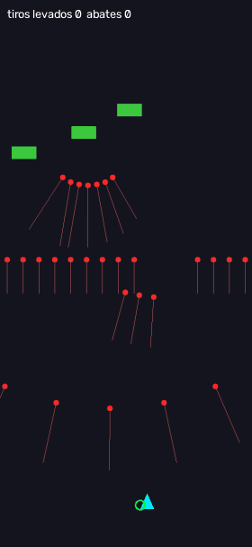

# AutoSpaceShooterCore

Núcleo reutilizável para bots de **shooters verticais** (estilo *bullet hell*). Ele faz a parte que todo jogo do gênero tem em comum: **desviar dos projéteis** e **ficar na linha de tiro dos inimigos** para abatê-los.

O core **não é um bot de um jogo específico**. Cada jogo vira um *produto* que reaproveita o core e implementa só o que é dele: como enxergar a tela, como mover a nave e as regras próprias.



*Linhas vermelhas: trajetória prevista de cada projétil. Círculo verde: destino escolhido pelo planejador.*

## Por que um core

O projeto segue a ideia de **linha de produto de software**: um núcleo comum, testado uma vez, e **pontos de variação** bem definidos, onde cada produto se encaixa.

```
            ┌──────────────────────── AutoSpaceShooterCore (comum a todos) ────────────────────────┐
quadro ──►  │ GameAdapter.detect ─► Tracker ─► SpaceTimePlanner ─► RelativePilot ─► TouchInput   │ ──► jogo
            │  (variação)          rastreio    esquiva + ofensiva   controle c/ latência (variação)│
            │                      ShipEstimator · AsyncPlanner · DodgeLoop                      │
            └────────────────────────────────────────────────────────────────────────────────────┘
```

| Parte | O que faz | Fica no core? |
|---|---|---|
| `tracking.Tracker` | Velocidade de cada projétil entre quadros, memória de projéteis que somem por instantes, inimigos que descem viram obstáculos móveis | Sim |
| `planner.SpaceTimePlanner` | Planejamento no **espaço-tempo**: grade de posições × passos de tempo, programação dinâmica *maximin* (maximiza a menor folga até os projéteis previstos ao longo de 1,2 s) e termo de **ofensiva** (preferência pela coluna de tiro dos inimigos quando já está seguro) | Sim |
| `pilot.RelativePilot` | Converte "quero a nave em (x, y)" em movimento contínuo de um controle relativo (arrastar), em passos pequenos, compensando a latência controle → vídeo | Sim |
| `ship.ShipEstimator` | Posição robusta da nave: descarta leituras impossíveis e, quando a nave some (flash de dano, efeitos), estima a posição pelo movimento já enviado ao controle | Sim |
| `loop.DodgeLoop` / `AsyncPlanner` | Loop genérico quadro → visão → rastreio → plano → piloto, com o planejador numa thread | Sim |
| `GameAdapter` | **Como enxergar o jogo**: nave, projéteis e inimigos num quadro; fim da partida; ajustes por quadro (ex.: modo defensivo com vida baixa) | **Não** (ponto de variação) |
| `TouchInput` / `FrameSource` | **Como mover a nave** e **de onde vêm os quadros** (celular, janela do PC, simulador) | **Não** (ponto de variação) |
| `CoreConfig` | Geometria e afinação: tamanho da tela, faixa da nave, velocidades, margens | Configuração |
| `SpaceTimePlanner.aim_cost` | Regra de mira. O padrão supõe armas que atiram reto para cima; outro tipo de mira é uma subclasse | Gancho |

## Funcionalidades
- Esquiva planejada (não só reativa): encontra caminhos em zigue-zague por vãos de "muros" de projéteis.
- Ofensiva com limiar de segurança: só sai da coluna do inimigo quando o risco passa de um limite configurável.
- Compensação de latência do controle e estimativa da nave quando a detecção falha.
- Parâmetros escaláveis para qualquer resolução (`for_screen(largura, altura)`).
- **Arena sintética** (`shooter_core.sim`): um shooter mínimo que gera quadros de verdade e recebe toques com latência, para testar o core sem nenhum jogo de terceiros.

## Tecnologias
- Python 3.10+
- NumPy (planejamento vetorizado)
- OpenCV (visão do adaptador de exemplo e janela da demonstração)

## Como rodar
```bash
git clone https://github.com/jgmtz/AutoSpaceShooterCore.git
cd AutoSpaceShooterCore
python -m venv .venv
.venv\Scripts\activate            # Linux/macOS: source .venv/bin/activate
pip install -r requirements.txt

python examples/demo_arena.py                  # o core jogando a arena (Esc fecha)
python examples/demo_arena.py --parado         # mesma arena com a nave parada, para comparar
python -m unittest discover -s tests -v        # testes
```

Na arena sintética (30 s de jogo, mesmas sementes):

| Semente | Nave parada | Com o core |
|---|---|---|
| 0 | 44 tiros levados, 3 abates | 11 tiros levados, 8 abates |
| 1 | 51 tiros levados, 3 abates | 4 tiros levados, 7 abates |

## Criando um produto para outro jogo
1. **Adaptador**: implemente `detect(img, ship_hint)` devolvendo um `Observation` (nave, projéteis, inimigos). Pode ser template matching, cor, um detector treinado ou o estado interno, se o jogo for seu.
2. **Controle e quadros**: qualquer objeto com `touch_down`, `touch_move` e `touch_up` (toque no celular, mouse) e uma fonte de quadros com `next_frame`.
3. **Configuração**: `for_screen(largura, altura)` e, depois, ajuste fino medido no próprio jogo.
4. Rode o `DodgeLoop` ou use os componentes no seu próprio loop.

```python
from shooter_core import DodgeLoop, GameAdapter, Observation, RelativePilot, for_screen

class MeuJogo(GameAdapter):
    def detect(self, img, ship_hint=None):
        ...  # visão específica do jogo
        return Observation(ship=(x, y), bullets=[(bx, by), ...], enemies=[(ex, ey, r), ...])

cfg = for_screen(1080, 2340)
loop = DodgeLoop(MeuJogo(), RelativePilot(meu_controle, cfg.pilot), cfg)
loop.run(minha_fonte_de_quadros)
```

### Usando IA para adaptar as features de cada jogo
Como o core concentra a lógica comum e isola o que muda, adaptar o bot a um jogo novo vira uma tarefa bem delimitada. Por isso ela combina com ferramentas de IA (assistentes de código e modelos de visão computacional). Exemplos:
- gerar ou ajustar o **detector** de um tipo novo de projétil ou inimigo a partir de prints do jogo;
- escrever o **adaptador de controle** de outra plataforma (teclado, mouse, emulador);
- propor **valores de configuração** a partir de gravações e medir o efeito na arena sintética;
- criar **regras próprias** de um jogo via `plan_overrides` (ex.: modo defensivo).

O que muda de um jogo para outro fica nos pontos de variação. O core continua o mesmo e é validado pelos testes, então uma alteração feita com IA não quebra a esquiva e a ofensiva sem que os testes acusem.

## Produto de exemplo
[`SpaceShooterGWZ`](https://github.com/jgmtz/SpaceShooterGWZ): o produto que deu origem ao core, um bot para um shooter de celular controlado pelo PC via scrcpy. O algoritmo foi extraído de lá para cá. Testes de regressão provam que o produto, montado sobre o core, toma **exatamente as mesmas decisões** que tomava antes da extração.

## Uso responsável
Projeto de estudo de **automação e visão computacional**. Use em jogos próprios, simuladores ou ambientes offline. Respeite os termos de uso de cada jogo e não use para obter vantagem em jogos online competitivos.

## Contexto
Projeto pessoal que aplica conceitos de **linha de produto de software** da disciplina de Reuso de Software (Engenharia de Software, PUCPR), 2026.

## Licença
[MIT](LICENSE)
